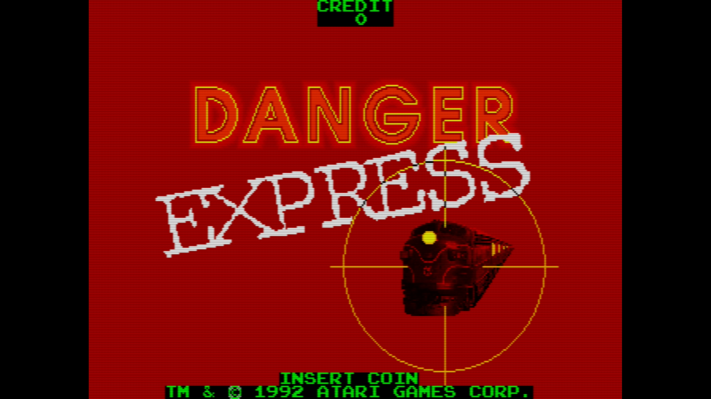
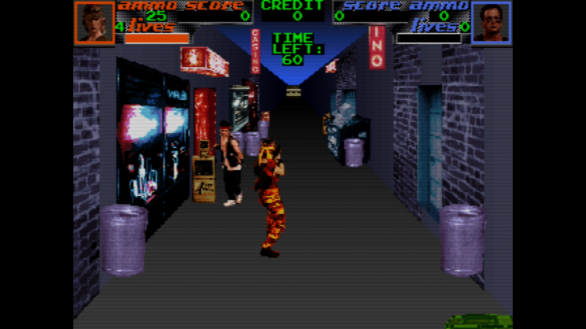
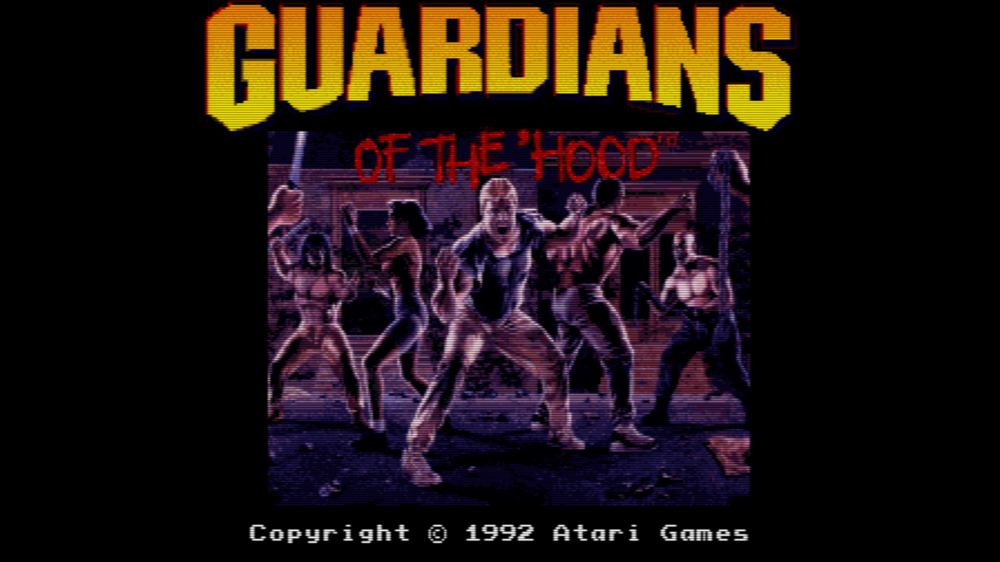
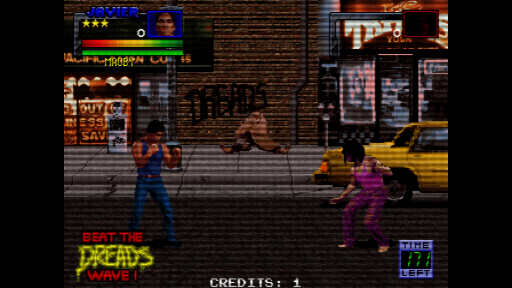
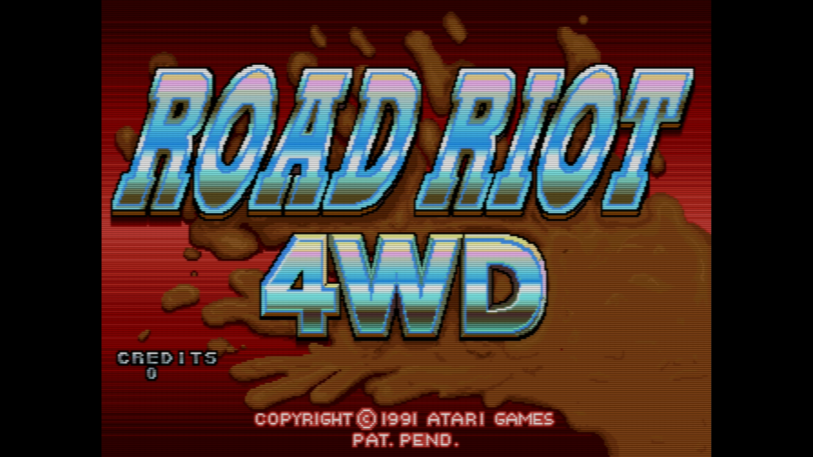
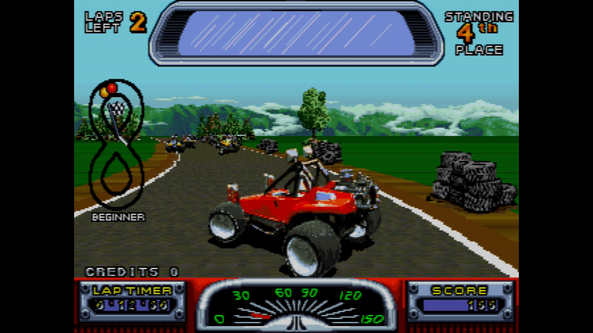

# Atari G42 for [MiSTer](https://github.com/MiSTer-devel/Main_MiSTer/wiki)

> **AI disclosure:** this core was developed using AI and MAME as a reference.
> (Claude, by Anthropic - Opus 5.5 & Sonnet 5.5).

An FPGA implementation of the Atari Games G42 arcade board (1991-1992), the
68000-based platform behind Road Riot 4WD, Guardians of the 'Hood and Danger
Express. All three games are playable on a DE10-Nano, with sound.

## Table of Contents

- [Hardware](#hardware)
- [Games](#games)
- [ROMs](#roms)
- [Building](#building)
- [Credits and references](#credits-and-references)
- [License](#license)

## Hardware

| | |
|---|---|
| Main CPU | Motorola 68000 @ 14.318181 MHz |
| Protection | SLOOP: an 8 KB bank window at $078000, switched by address sequences (Road Riot and Guardians; not on Danger Express) |
| Coprocessor | ASIC65: a TMS32015 DSP running its own program on Road Riot; Guardians and Danger Express use its fixed commands |
| Video | 336 × 240 visible in a 456 × 262 raster, 59.923 Hz |
| Layers | 128 × 64 playfield of 8 × 8 tiles, 6 bpp, per-line scroll; 64 × 32 text layer; RLE motion objects, scaled, double-buffered |
| Palette | 2,048 entries, IRGB-1555 |
| Sound (JSA III) | 6502 @ 1.789773 MHz, YM2151 @ 3.579545 MHz, OKI6295 @ 1.193182 MHz with banked samples, mono |
| Settings | 2 KB EEPROM (2816) behind an unlock; no DIP switches |
| Road Riot | ADC0809 for the wheel and pedal |

Board photographs and chip lists: [System 16 — Atari G42 Hardware](https://www.system16.com/hardware.php?id=774).

## Games

| Game | Main set | Title Screen | Gameplay |
|---|---|---|---|
| Danger Express (prototype) | dangerex (prototype) |  |  |
| Guardians of the 'Hood | guardian |  |  | 
| Road Riot 4WD | roadriot (04 Dec 1991, conversion kit); roadriota, roadriotb |  |  |

## ROMs

ROMs are **not** included in this repository; you need your own dumps of the
games.  Files are found by CRC. Put `roadriot.zip`, `guardian.zip`
and `dangerex.zip` in `games/mame`, the MRA files from `mra/` in `_Arcade`
(the two older Road Riot 4WD sets are in `_alternatives/_Road Riot 4WD`, where
MiSTer lists other versions of a game) and the core in `_Arcade/cores`.

## Credits and references

- [MAME](https://www.mamedev.org/), the reference for the hardware's behaviour:
  `atarig42.cpp`, `atarig42_v.cpp` (Aaron Giles), `atarirle.cpp`, `asic65.cpp`,
  `atarijsa.cpp`, `eeprompar.cpp`, `adc0808.cpp`. No MAME code is compiled into
  the core
- [MiSTer-CRT-Adjust](https://github.com/rmonic79/MiSTer-CRT-Adjust): Umberto
  Parisi (rmonic79), with Andrea Bogazzi (asturur).
- [fx68k](https://github.com/ijor/fx68k): Jorge Cwik (the 68000)
- T65: Daniel Wallner, Mike Johnson, Wolfgang Scherr and Morten Leikvoll (the
  JSA III's 6502)
- [JT51 and JT6295](https://github.com/jotego): Jose Tejada (jotego) (the
  YM2151 and OKI6295)
- [Template_MiSTer](https://github.com/MiSTer-devel/Template_MiSTer): Alexey
  Melnikov (Sorgelig) and the MiSTer-devel team.
- ppriest: [MiSTer-CoreSkill](https://github.com/ppriest/MiSTer-CoreSkill), its
  clock guidance

## License

The core is released under the GNU General Public License v3.0 (`LICENSE`).
CRT Adjust in `rtl/crt/` is GPL-3.0 as well (`rtl/crt/LICENSE`). `sys/`, fx68k,
T65, JT51 and JT6295 keep their own licences and authorship.

No ROM data is included or distributed.
