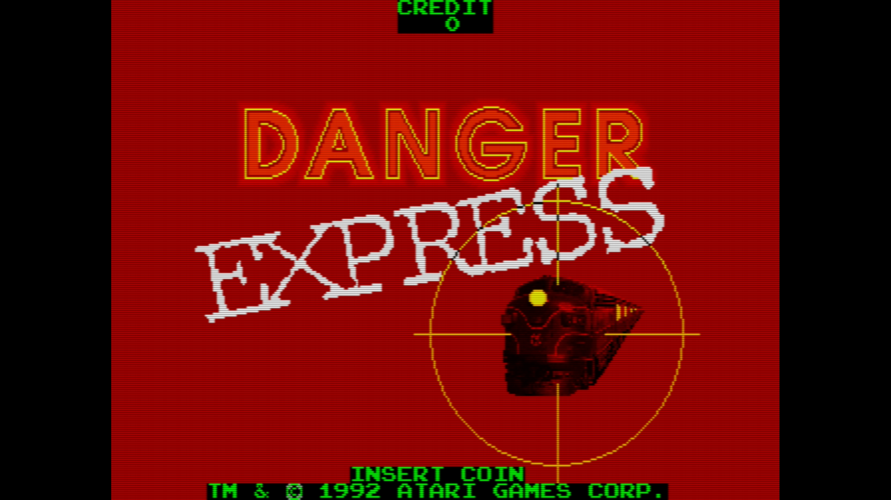
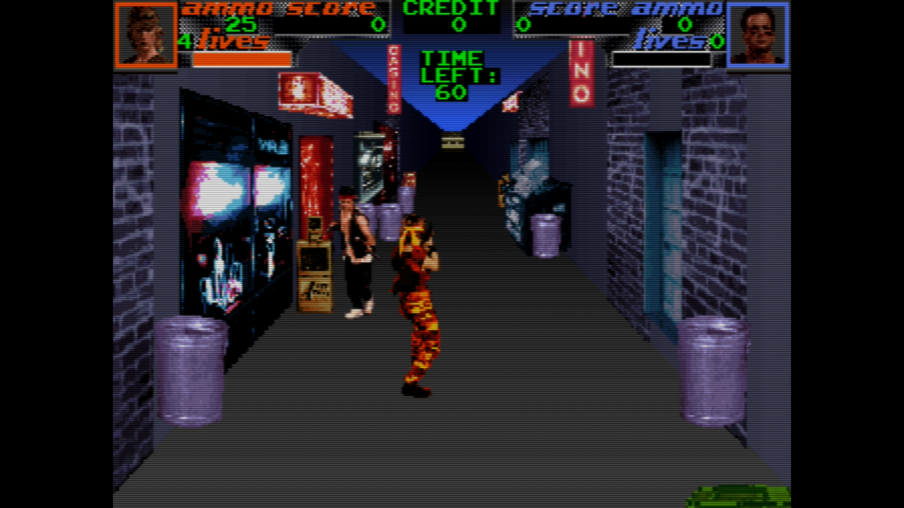

# Danger Express

[Back to the main README](../README.md)

 

| | |
|---|---|
| Sets | dangerex (prototype, 1992) |
| ROM zip | `dangerex.zip` (MAME's Danger Express set) |
| Players | 2 |
| Sound | JSA III board: 6502, YM2151 and OKI6295, mono |

## Extra content

- **Start button**: the cabinet has no start buttons; after a coin, Jump starts
  a game. The pad's Start is wired to the same switch, so it does what the
  screen asks.
- **Service Menu** (OSD): the game's own test menu, from the next reset.

CRT Adjust, Auto-Width and the other OSD options apply to every game.

## Controls

| Input | Use |
|---|---|
| Stick | Move |
| A | Fire |
| B | Jump (also starts a game) |
| X | Duck |
| Start | Same as Jump |
| Select | Coin |

The buttons are the MRA's defaults and can be remapped in MiSTer. Controllers
1 and 2 play players 1 and 2, each with its own Coin button.

## Starting a game

One coin makes one credit. After a coin, a player's **Jump** starts their game:
the credit is used and the mission briefing appears. Fire and Duck do not start
a game; the attract demo keeps running.

## Settings

Coinage, difficulty and the other operator settings are in the game's own
service menu: turn on **OSD → Service Menu** and reset, change the settings,
then turn it off and reset to play. They are kept in the game's EEPROM, which
the core saves to the SD card. In the menu the stick moves the cursor, Fire
also advances it, and Duck selects ("Choose then press DUCK Button").

## Hardware notes

- There is no SLOOP protection on this prototype.
- The ASIC65 is used only by the game's service-mode test.
- The prototype reads a few debug switches (toggles, step, freeze, test
  colours); the core holds them released.
