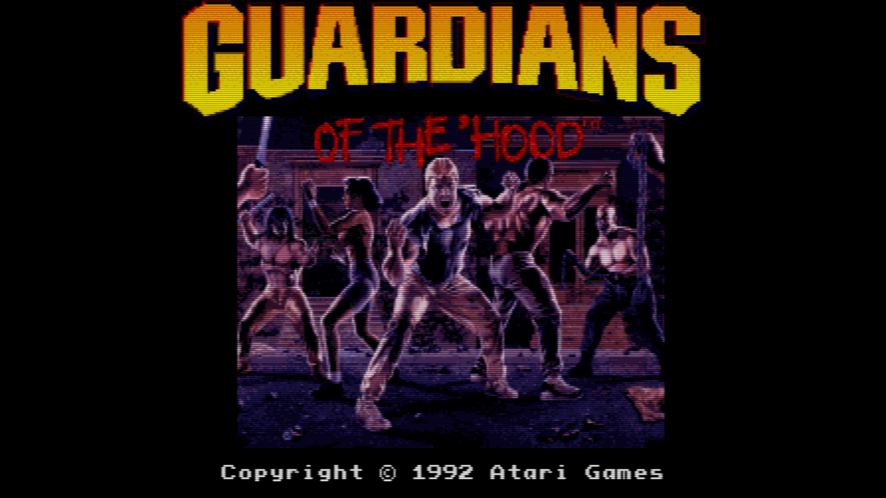

# Guardians of the 'Hood

[Back to the main README](../README.md)

 

| | |
|---|---|
| Sets | guardian (1992) |
| ROM zip | `guardian.zip` (MAME's Guardians of the 'Hood set) |
| Players | 3 (set up for 2 by default) |
| Sound | JSA III board: 6502, YM2151 and OKI6295, mono |

## Extra content

- **Start button**: the cabinet has no start buttons; after a coin, Defend
  starts a game. The pad's Start is wired to the same switch for each player, so
  it does what the screen asks ("PRESS START").
- **Three players**: controllers 1 to 3 play players 1 to 3. The game ships set
  up for 2 players; choose 3-PLAYER in its game options (see
  [Settings](#settings)).
- **Service Menu** (OSD): the game's own test menu, from the next reset.

CRT Adjust, Auto-Width and the other OSD options apply to every game.

## Controls

| Input | Use |
|---|---|
| Stick | Move (8-way) |
| Y | Punch 1 |
| X | Punch 2 |
| B | Kick 1 |
| A | Kick 2 |
| R | Defend (also starts a game) |
| Start | Same as Defend |
| Select | Coin |

The buttons are the MRA's defaults and can be remapped in MiSTer. There is no
jump. Each player has a Coin button; player 1's drops into the first coin
mechanism and players 2 and 3 share the second.

## Settings

Coinage, difficulty and the other operator settings are in the game's own
service menu: turn on **OSD → Service Menu** and reset, change the settings,
then turn it off and reset to play. They are kept in the game's EEPROM, which
the core saves to the SD card. In the game options, **START TO SAVE & EXIT** is
done with Defend.

The factory settings are `CABINET CONFIGURATION: 2-PLAYER`, so the switch test
shows only players 1 and 2. For the third player, set `3-PLAYER` in the game
options.

## Hardware notes

- The SLOOP bank window is used in play; the ASIC65 only serves the protection
  here (reset, init-banks, set-bank and verify-bank commands).
