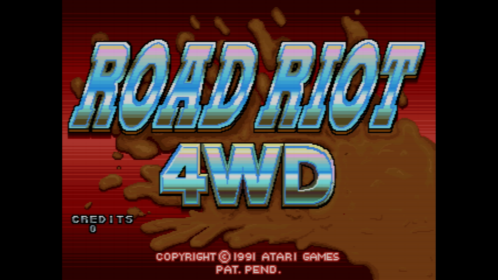
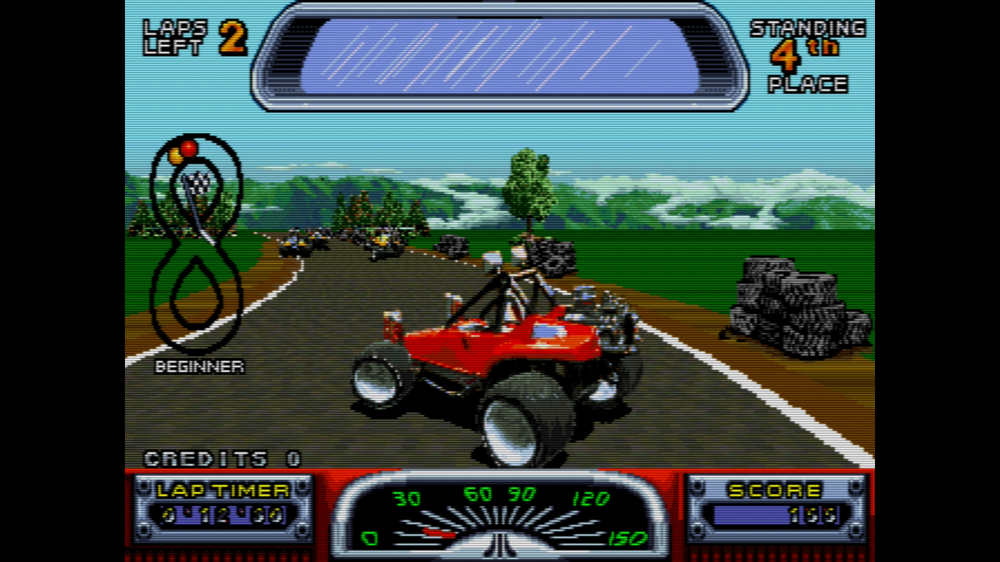

# Road Riot 4WD

[Back to the main README](../README.md)

 

| | |
|---|---|
| Sets | roadriot (04 Dec 1991, conversion kit, main MRA); roadriota (13 Nov 1991, conversion kit) and roadriotb (04 Jun 1991, dedicated twin) in `_alternatives/_Road Riot 4WD` |
| ROM zip | `roadriot.zip` (MAME's merged Road Riot 4WD set) |
| Players | 1 |
| Sound | JSA III board: 6502, YM2151 and OKI6295, mono |

## Extra content

Road Riot 4WD is the only game with a wheel and a pedal, so it has its own
control options:

- **Wheel from an analog stick** (Controls page): the left stick steers. The
  d-pad also steers, ramping out while held and back to the centre on release,
  as a keyboard does in MAME, and so does a paddle.
- **Wheel sensitivity** (Controls page: Medium, High, Low; Medium by default):
  scales the left stick's travel, 100 %, 150 % and 50 %. The page shows once
  a Road Riot MRA has loaded.
- **Gas pedal** from a button (ramps up while held and back down on release)
  or from the right stick pushed up; the larger of the two counts.
- **Service Menu** (OSD): the game's own test menu, from the next reset.

CRT Adjust, Auto-Width and the other OSD options apply to every game.

## Controls

| Input | Use |
|---|---|
| Left analog stick | Steering wheel (the d-pad and a paddle also steer) |
| R | Gas pedal (or the right stick pushed up) |
| A | Left trigger |
| B | Right trigger |
| Start | Start |
| Select | Coin |

The buttons are the MRA's defaults and can be remapped in MiSTer.

## Settings

Coinage, difficulty and the other operator settings are in the game's own
service menu: turn on **OSD → Service Menu** and reset, change the settings,
then turn it off and reset to play. They are kept in the game's EEPROM, which
the core saves to the SD card. The wheel and pedal calibration is in the
game's switch test.

In the menu, the left trigger moves the cursor up, the right trigger moves it
down and Start does the test. With the factory settings two coins make one
credit; Start then starts the race.

## Hardware notes

- The ASIC65 runs Road Riot's own DSP program; Guardians and Danger Express
  use its fixed commands.
- The three sets use the same SLOOP bank protocol.
- The wheel and pedal are read through the board's ADC0809.
